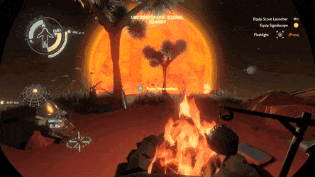

<!-- HEADER CYBERPUNK ANIMADO -->

  

  

   

  <!-- BARRA DE CONTATO RÁPIDO & PORTFÓLIO -->
  

    
    
    
    
    
  

## `>_` Sobre Mim

Sou **Vinícius Soares**, mais conhecido como **Vini**, Desenvolvedor Fullstack (**Web, Desktop e Cloud**) e Analista de Sistemas com **+4 anos de experiência** entregando sistemas de alta disponibilidade e projetos nacionais e internacionais de **P&D/R&D**.

- 🚀 **Atuação & Liderança:** Ex-Líder de Time e Analista no _Instituto Atlântico_ em projetos internacionais de P&D para a **HPE (EUA)**, desenvolvendo sistemas de classificação de ativos computacionais e monitoramento conteinerizado.
- ⚡ **Performance na Prática:** Experiência em sistemas corporativos de larga escala (_Alltax Platform / TIMP_), com histórico de otimização crítica de banco de dados (reduzindo tempo de resposta de **3 min para menos da metade**).
- 🎯 **Foco Atual:** Arquitetura limpa, aplicações web modernas, cloud, automação e sistemas embarcados.

<!-- DICA: Se quiser adicionar um GIF cyberpunk pessoal, descomente a linha abaixo e insira o caminho/link do GIF -->

## `>_` Stack & Conhecimentos Práticos

### `// Back-End & Bancos de Dados`

### `// Front-End & UI/UX`

### `// Cloud, DevOps & Observabilidade`

### `// Arquitetura, Testes & Ferramentas`

## `>_` Portfólio Open-Source

Explore todos os meus repositórios em **[github.com/vinisoaresti](https://github.com/vinisoaresti?tab=repositories)** ou confira alguns projetos públicos em destaque:

| Projeto                        | Descrição                                                                                            | Links                                                                                                                       |
| :----------------------------- | :--------------------------------------------------------------------------------------------------- | :-------------------------------------------------------------------------------------------------------------------------- |
| **Creative Integration Suite** | SaaS (TCC) que automatiza fluxos de ideação, desenvolvimento e lançamento de conteúdo para agências. | [Repositório](https://github.com/vinisoaresti/creativeIntegrationSuite_old) • [Live Demo](https://creatis-ten.vercel.app/)  |
| **Instagram Clone**            | Interface web responsiva inspirada na tela de login do Instagram em HTML, CSS e JavaScript.          | [Repositório](https://github.com/vinisoaresti/instagramClone) • [Live Demo](https://vinisoaresti.github.io/instagramClone/) |
| **Timbiriche**                 | Versão web minimalista do clássico jogo dos pontinhos com foco em lógica e manipulação de DOM.       | [Repositório](https://github.com/vinisoaresti/timbiriche) • [Live Demo](https://vinisoaresti.github.io/timbiriche/)         |

## `>_` Formação, Destaques & Idiomas

- 🎓 **Análise e Desenvolvimento de Sistemas** — IFPE Garanhuns _(Cursando)_ | **Técnico em Informática** — IFPE Garanhuns _(Concluído)_
- 🏆 **Reconhecimentos:** Destaque institucional e monitor no _Academy Future_ (Instituto Atlântico) • 1º lugar no vestibular IFPE (2015)
- 🌐 **Idiomas:** Português Nativo (`C2`) • Inglês Avançado/Proficiente (`C1` — TOEFL-ITP 653/677) • Francês Básico (`A1`)

## `>_` Vamos Conversar?

  
Disponível para oportunidades, projetos e conexões técnicas (Presencial / Remoto / Híbrido)

  
  
  
  
  

  

  

